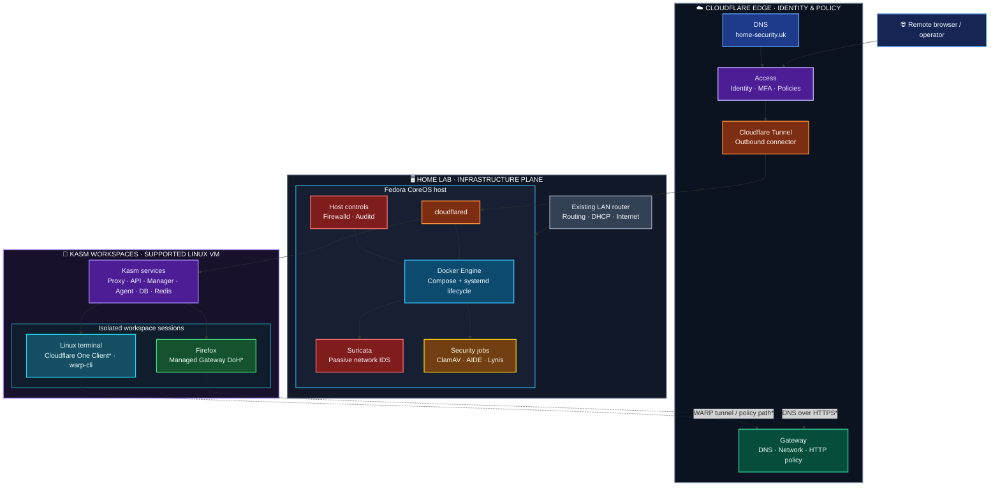

# AI Stack

<p align="center">
  <strong>Secure workspaces. Observable infrastructure. Guarded automation.</strong><br>
  A modular homelab platform built around Fedora CoreOS, Docker Compose, Kasm Workspaces, and Cloudflare Zero Trust.
</p>

<p align="center">
  
  
  
  
  
</p>

> **Project status:** This repository is an implementation bundle and architecture reference, not proof of a fully deployed or production-hardened system. Read the deployment boundaries and validation gates before enabling services.

## At a glance

AI Stack separates the immutable infrastructure host, browser-delivered workspaces, and Cloudflare's edge services. The existing LAN router remains the network gateway. Fedora CoreOS (FCOS) is a server/container host—not a router, NAT gateway, or transparent bridge.

### Architecture



<sub>* Cloudflare One Client and managed Firefox DoH are planned workspace integrations. The supplied WARP image is currently an install layer/proof of concept; daemon startup, enrollment, TUN access, posture behavior, and leak prevention still require runtime validation. The diagram shows intended traffic paths, not verified connectivity. The Cloudflare public hostname and Access policy must be configured separately.</sub>

## Design principles

- **Immutable host first.** Keep the FCOS host focused on infrastructure and container orchestration. Use supported host-management mechanisms; do not treat it like a mutable general-purpose server.
- **Clear trust boundaries.** Host controls, application services, workspace sessions, and Cloudflare edge policy have separate responsibilities.
- **No accidental routing.** The LAN router remains responsible for routing and Internet access. Firewalld protects the FCOS host; it does not automatically protect every LAN device.
- **Least privilege.** Avoid privileged containers, keep capabilities narrow, use read-only mounts where practical, and keep credentials out of images and Git.
- **Fail closed where it matters.** A WARP connected indicator is not a kill switch. Enforce and test egress restrictions independently of client status.
- **Verify before relying on it.** A running container is not proof of packet visibility, host coverage, policy enforcement, or a successful workspace launch.

## Component map

| Component | Runs on | Responsibility | Current boundary |
|---|---|---|---|
| Fedora CoreOS | Physical/virtual server | Immutable container host | Does not route or NAT LAN traffic |
| Docker Engine + Compose | FCOS host | Runs the Compose-managed services | Rootful engine; install and lifecycle are host concerns |
| Firewalld | FCOS host | Host ingress policy | Host protection only; no LAN-wide firewall claim |
| Auditd | FCOS host | Kernel audit subsystem | Host-native; not containerized |
| Suricata | FCOS host, host network | Passive IDS visibility on selected NIC | Not IPS; visibility is limited to traffic reaching that NIC |
| ClamAV | Compose service/job | Malware scan of configured scan target | Read-only target; detections are logged, not auto-deleted |
| AIDE | Compose job | Integrity baseline/check of configured scan target | Manual baseline review; no automatic re-baselining |
| Lynis | Compose job | Audit of its own container environment | Not a complete FCOS host audit |
| Kasm Workspaces | Separate supported Linux VM | Browser-delivered terminal and Firefox sessions | Installed and managed by Kasm's installer, outside this Compose project |
| `cloudflared` | FCOS host | Outbound Cloudflare Tunnel connector | Tunnel token supplied through a protected file secret |
| Cloudflare One Client | Linux terminal workspace | WARP client for that workspace endpoint | Experimental until runtime and enforcement gates pass |
| Firefox DoH | Firefox workspace | Encrypted DNS to Cloudflare Gateway | Must be managed and tested to prevent resolver bypass |

## Repository layout

```text
ai-stack/
├── compose.yaml                       # FCOS security services
├── Containerfile.audit                # Audit-tools image build
├── .env.example                       # Non-secret configuration template
├── config/
│   ├── aide/aide.conf                 # AIDE policy for the scan target
│   └── suricata/rules/local.rules     # Local Suricata rules
├── data/                              # Runtime state (create locally; do not commit)
├── logs/                              # Runtime logs (create locally; do not commit)
├── scripts/                           # AIDE and Lynis entrypoints
├── systemd/                           # Host units and timers
└── kasm/
    ├── README.md                      # Kasm / Cloudflare integration notes
    ├── tunnel/compose.cloudflared.yaml
    └── workspace/                     # Custom Kasm Linux terminal image
```

## Deployment model

### 1. FCOS host — prepare the runtime

Install and validate Docker Engine and Compose v2 through the approved FCOS package-layer workflow. This repository does not install Docker or change the host firewall automatically.

```bash
# FCOS host
run0 install -d -m 0750 /opt/ai-stack
run0 install -d -m 0750 /var/lib/ai-stack/scan-target
run0 install -d -m 0750 /opt/ai-stack/logs/clamav
run0 install -d -m 0750 /opt/ai-stack/logs/aide
run0 install -d -m 0750 /opt/ai-stack/logs/lynis
```

Copy this repository to `/opt/ai-stack`, then configure it:

```bash
# FCOS host
cd /opt/ai-stack
cp .env.example .env
$EDITOR .env
ip -br link                 # identify the real Suricata interface
```

Set `SURICATA_INTERFACE` to the observed interface and `SCAN_TARGET_PATH` to the dedicated directory. Do not point scan jobs at `/` or pseudo-filesystems.

### 2. Validate and start the security services

```bash
# FCOS host
cd /opt/ai-stack
docker version
docker compose version
docker compose config --quiet
docker compose --profile build build audit-tools-build
docker compose --profile ids up -d suricata
docker compose --profile antivirus up -d clamav
```

`docker compose config --quiet` checks Compose configuration and interpolation. It does not prove that Suricata sees the intended traffic or that a rule set is effective.

### 3. Install host lifecycle units

```bash
# FCOS host
run0 install -m 0644 systemd/*.service systemd/*.timer /etc/systemd/system/
run0 systemctl daemon-reload
run0 systemctl enable --now ai-stack-compose.service
run0 systemctl enable --now ai-stack-clamav-scan.timer ai-stack-lynis-audit.timer
```

Initialize AIDE only after the scan target is populated and reviewed:

```bash
# FCOS host — one-time, deliberate baseline operation
run0 systemctl start ai-stack-aide-init.service
run0 systemctl status ai-stack-aide-init.service
```

Back up and protect the baseline, then enable the check timer:

```bash
# FCOS host
run0 systemctl enable --now ai-stack-aide-check.timer
```

Never automatically refresh the AIDE baseline after a reported change.

### 4. Deploy Kasm separately

Kasm is not part of `compose.yaml`. Install it on a supported Linux VM with the required rootful Docker Engine and Compose v2 versions. Kasm's installer owns its internal services and upgrades. Do not combine Kasm's internal containers with this generic Compose project.

The target workspaces are:

- Linux terminal — custom image recipe in `kasm/workspace/`; Cloudflare One Client runtime remains a proof of concept.
- Firefox — browser workspace with managed Gateway DoH configuration.

The FCOS host is not listed as a supported Kasm installation OS in the supplied deployment guidance. Keep Kasm on a supported VM unless compatibility is explicitly validated and accepted.

### 5. Connect Cloudflare Tunnel

The `kasm/tunnel/compose.cloudflared.yaml` fragment runs on the FCOS host. It connects outbound to a remotely managed Cloudflare Tunnel; it is not a router, bridge, or VPN for the host.

Create the token file securely on FCOS:

```bash
# FCOS host
run0 install -d -m 0700 /etc/ai-stack/secrets
# Transfer the token through a secure channel; do not paste it into shell history.
run0 install -o root -g root -m 0600 /secure/staging/cloudflared-token \
  /etc/ai-stack/secrets/cloudflared-token
```

Validate the merged Compose configuration before any deployment:

```bash
# FCOS host
docker compose \
  -f /opt/ai-stack/compose.yaml \
  -f /opt/ai-stack/kasm/tunnel/compose.cloudflared.yaml \
  config --quiet
```

Configure the public hostname (recommended: `kasm.home-security.uk`) and its Cloudflare Access application/policy in the Cloudflare dashboard. No router port-forward is required for the outbound tunnel. The hostname and policy are not provisioned by this repository.

## Operations

```bash
# FCOS host
cd /opt/ai-stack
docker compose ps
docker compose logs --tail=100 suricata clamav
run0 systemctl list-timers 'ai-stack-*'
run0 journalctl -u ai-stack-clamav-scan.service -n 100 --no-pager
run0 journalctl -u ai-stack-aide-check.service -n 100 --no-pager
run0 journalctl -u ai-stack-lynis-audit.service -n 100 --no-pager
```

Useful service controls:

```bash
# FCOS host
run0 systemctl status ai-stack-compose.service
run0 systemctl start ai-stack-clamav-scan.service
run0 systemctl start ai-stack-lynis-audit.service
run0 systemctl start ai-stack-aide-check.service
```

## Security and operational gates

Before treating the platform as production-ready, close these gates:

- [ ] Pin container images to tested immutable digests and document an update/rollback process.
- [ ] Verify Firewalld's default-deny inbound policy and trusted-LAN administration rules on the FCOS host.
- [ ] Verify Auditd is enabled and collecting the intended host events.
- [ ] Confirm Suricata is attached to the correct physical NIC and receives representative traffic; retain passive IDS mode unless a separately reviewed IPS design is implemented.
- [ ] Confirm scan scope, SELinux labels, logs, and backup/restore behavior for ClamAV and AIDE.
- [ ] Review and protect the AIDE baseline before enabling its recurring check.
- [ ] Treat Lynis output as container-scoped; perform a separately validated host-aware audit for FCOS.
- [ ] Validate Kasm on a supported VM, including admin access and a launch/stop cycle for both workspaces.
- [ ] Protect the Cloudflare Tunnel token as a secret and verify Access policies before exposing the hostname.
- [ ] For WARP, validate `/dev/net/tun`, minimum required capabilities, `warp-svc` lifecycle, enrollment, posture behavior, and direct-egress leak prevention.
- [ ] For Firefox DoH, enforce the intended Gateway resolver and verify that browser policy cannot silently fall back to an unapproved resolver.
- [ ] Test restore procedures for Kasm data, configuration, secrets, and AIDE baseline.

## Known limitations

- Suricata is configured for passive IDS. Host networking does not make it a LAN-wide sensor: ordinary switched unicast traffic between other LAN devices may never reach the FCOS NIC. Use a switch mirror/SPAN port or network TAP for broader visibility.
- Firewalld on FCOS protects the host; it does not filter traffic for every other device on the LAN.
- ClamAV and AIDE operate on the explicitly configured scan target, not the entire FCOS root filesystem.
- Lynis runs in a container and does not constitute a full host audit.
- Cloudflare One Client inside a Kasm workspace represents that workspace container as the endpoint, not the physical laptop. Container posture semantics must be proven before relying on them.
- WARP connectivity alone is not an egress kill switch. A separate enforcement layer and failure tests are required.
- The architecture diagram is an intended design view. It is not deployment evidence.

## Troubleshooting quick checks

```bash
# FCOS host
ip -br link
docker compose ps
docker compose logs --tail=200 suricata
run0 journalctl -u ai-stack-compose.service -b --no-pager
run0 journalctl -u ai-stack-clamav-scan.service -n 100 --no-pager
```

If Suricata produces no useful events, first confirm the interface and packet visibility. If a Kasm workspace fails to start, inspect Kasm's own service logs and confirm the selected VM meets Kasm's supported OS and Docker requirements. Keep console access available when changing host firewall rules.

## Contributing and change safety

1. Inspect the current configuration and host state before editing.
2. Make the smallest change that meets the objective.
3. Validate Compose, shell scripts, systemd units, and image builds with the relevant tools.
4. Test in a disposable environment before enabling host services or exposing a public hostname.
5. Never commit `.env`, tunnel tokens, service tokens, certificates, private keys, database dumps, runtime logs, or generated security baselines.
6. Do not deploy, change Cloudflare resources, or alter production infrastructure without explicit approval.

## License

Add the license selected by the project owner before redistributing this repository.
